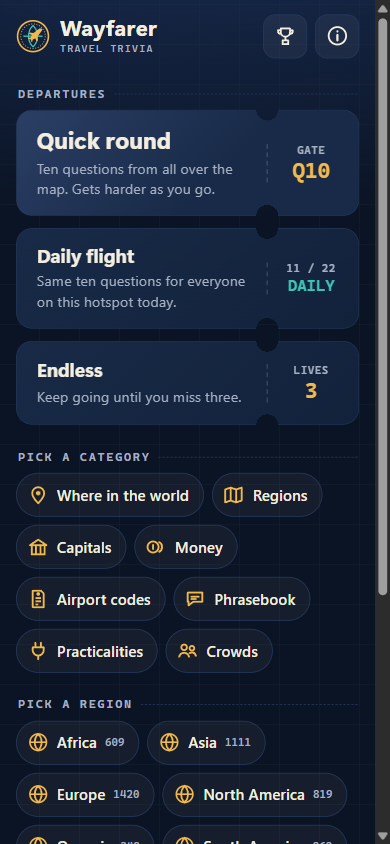
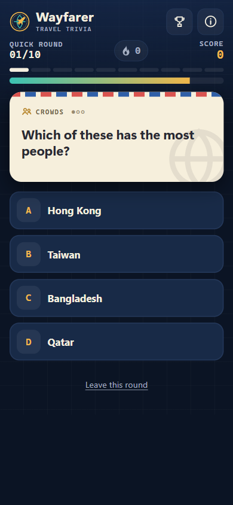
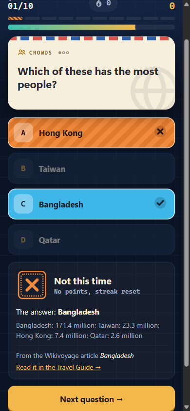

# Wayfarer

Travel trivia for the journey, an app for [AirplaneMode](https://github.com/jessewolcott/airplanemode).
About 5,400 multiple-choice questions built from Wikivoyage, the free travel guide: which country a
city is in, capitals, currencies, airport codes, how to say "thank you" in nearly 100 languages, and
the practical stuff (driving side, mains voltage, time zones, emergency numbers, calling codes).

Single player, phone first, fully offline. A shared leaderboard per mode lives on the box.

## How to play

- **Quick round**: ten questions from every category, getting harder as you go.
- **Daily flight**: the same ten questions for everyone on the hotspot today (the order of the
  answers is shuffled for each round). You can fly it again; the board keeps each name's best.
- **Endless**: keep going until you miss three, or until you've answered 300.
- **Pick a category** or **pick a region** (a continent) for a focused round.

Each question has four answers and, if you leave the timer on, 20 seconds. A right answer is worth
100–150 points (harder questions more), up to 50 more for speed (50 for the fastest answers,
down to none at 20 seconds) and a streak bonus of 10 per
answer in a row (up to 50). After each answer you see the right one and the Wikivoyage article it
came from, with a link to it in the Travel Guide when the guide is installed on the box.

At the end: score, accuracy, best streak, a per-category breakdown, a share text, and a name-only
leaderboard. Rounds the browser has seen recently are remembered so new rounds prefer new
questions. Reloading the page mid-round picks the round up again in that browser tab (the
question's timer keeps running); a new tab, or a restart of the app, starts over.

## Running it

```sh
docker compose up -d --build        # http://localhost:8773
python tests/test_wayfarer.py       # tests (Python 3.10+; pip install -r requirements.txt httpx)
```

On the box it runs from the platform repo at `/wayfarer/`.

## Configuration

| Variable | Default | |
|---|---|---|
| `DATA_DIR` | `/data` | Where the leaderboard (`scores.json`) is kept. Empty or not writable: in memory only. |
| `TZ` | UTC | The box's time zone: when the daily flight changes. |
| `BANK_PATH` | `bank/questions.json.gz` | The question bank. |
| `ROUND_TTL` | `10800` (3 h) | Seconds a round may sit idle before it's forgotten. |
| `MAX_ROUNDS` | `500` | Rounds kept in memory at once; the least recently used goes first. |

Memory: about 40 MB in use; the manifest asks for 64m. No model needed.

## How the questions are made

`bank/build.py` reads a Wikivoyage ZIM (Kiwix) offline and writes `bank/questions.json.gz`,
which ships in the image. See [bank/README.md](bank/README.md) for what each category is built
from and how to regenerate it when a new ZIM comes out.

## Screenshots

<p align="center">
  
  
  
</p>

<sub>From a laptop browser at phone size; not yet tested on real phones or hardware.</sub>

## Credits and licence

Questions are adapted from [Wikivoyage](https://en.wikivoyage.org/) articles by Wikivoyage
contributors, available under [CC BY-SA 4.0](https://creativecommons.org/licenses/by-sa/4.0/);
the question bank (`bank/questions.json.gz`) is shared under the same licence. Snapshot:
`wikivoyage_en_all_nopic_2026-09.zim` (2026-09-13).
